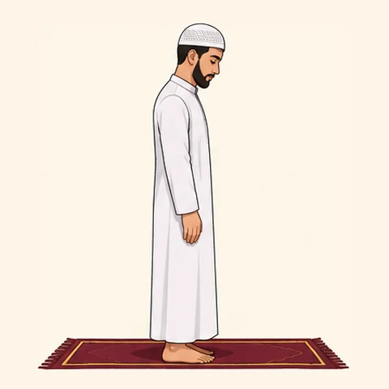
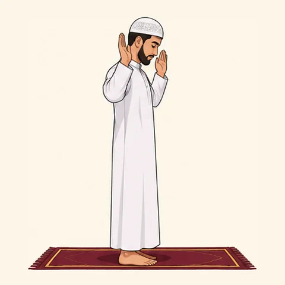
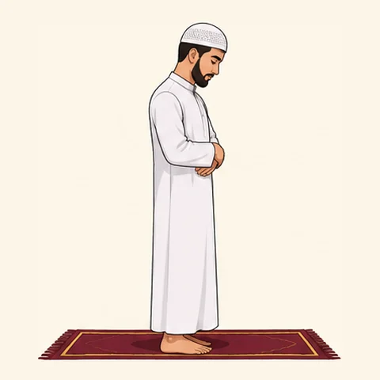
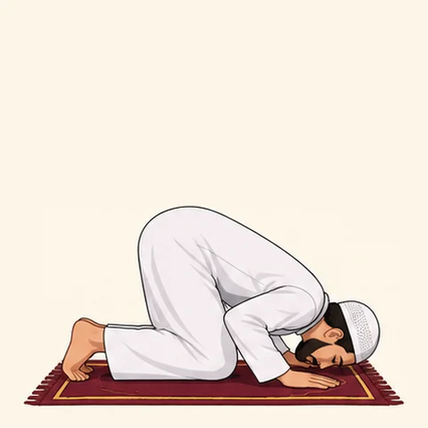
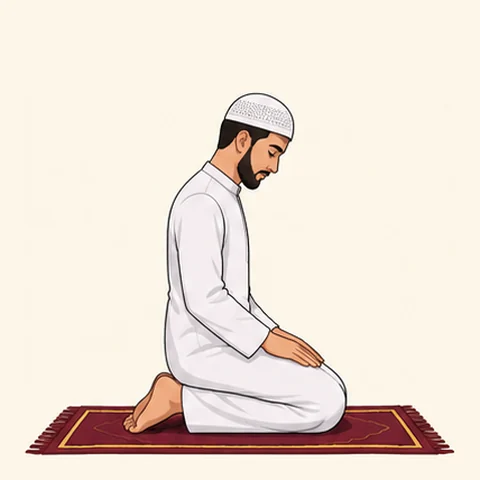
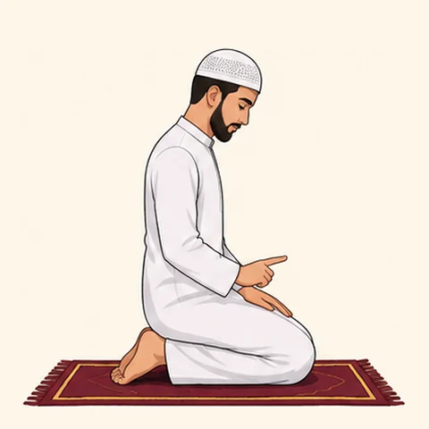
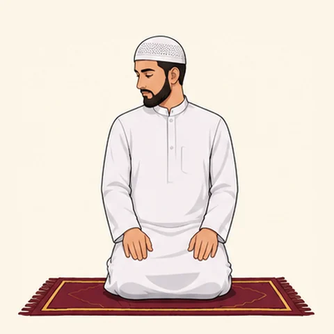
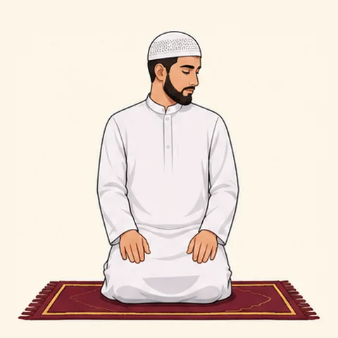
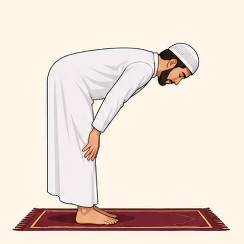

# Salah — imagens das posições da oração

Ilustrações livres (CC0) das posições da oração islâmica (salat), feitas para o guia [Salah](https://bernardodeveloper.github.io/salah/). Mesmo personagem e mesmo estilo em todas: vista lateral, rosto voltado para a Qibla (direita), tapete vinho, fundo creme.

## Posições

| Imagem | Arquivo | Posição | Quando |
|---|---|---|---|
|  | `posicoes/itidal.webp` | Em pé, braços soltos | Intenção (niyyah) e iʿtidāl (de pé após o rukuʿ) |
|  | `posicoes/takbir.webp` | Mãos ao lado das orelhas | Takbir de abertura |
|  | `posicoes/qiyam.webp` | Mão direita sobre a esquerda, no peito | Qiyām (recitação) |
|  | `posicoes/sujud.webp` | Prostração | Sujūd |
|  | `posicoes/jalsa.webp` | Sentado sobre os pés, mãos nas coxas | Jalsah (entre as prostrações) |
|  | `posicoes/tashahhud.webp` | Sentado, indicador direito levantado | Tashahhud |
|  | `posicoes/salam_right.webp` | Rosto para a direita (de frente) | Taslīm à direita |
|  | `posicoes/salam_left.webp` | Rosto para a esquerda (de frente) | Taslīm à esquerda |

**Falta:** rukuʿ correto (costas retas na horizontal). A versão gerada saiu com as costas inclinadas e ficou em `erros/` — ver abaixo.

## Erros comuns

| Imagem | Arquivo | Erro |
|---|---|---|
|  | `erros/ruku-costas-inclinadas.webp` | Rukuʿ com as costas inclinadas. O certo é dobrar o tronco até as costas ficarem retas e paralelas ao chão, cabeça alinhada com as costas, mãos firmes nos joelhos. |

## Formato

- WebP, 480 × 480 px, 8–13 KB cada. Fundo creme por volta de `#fcf5ea` (não transparente).
- Endereço direto: `https://bernardodeveloper.github.io/salah-imagens/posicoes/<arquivo>.webp`

## Como foram feitas

1. **Referência de postura**: ilustração CC0 de Ayman Alhasan no Wikimedia Commons — [Salat or Muslim Prayers — Illustration showing the sequence and recitations made in each posture](https://commons.wikimedia.org/wiki/File:Salat_or_Muslim_Prayers_-_Illustration_showing_the_sequence_and_recitations_made_in_each_posture.jpg).
2. **Geração**: uma folha 3 × 3 no ChatGPT com o prompt de [`fonte/prompt.md`](fonte/prompt.md) — um personagem original, desenhado do zero (nenhuma imagem de banco de imagens foi usada como entrada).
3. **Revisão manual** de cada posição; o que saiu errado vai para `erros/`, não para `posicoes/`.
4. **Recorte**: [`fonte/crop_sheet.py`](fonte/crop_sheet.py) detecta os painéis, enquadra e exporta em WebP.

```
python3 fonte/crop_sheet.py fonte/folha-chatgpt-v1.png posicoes
```

O histórico das tentativas (o que a IA errou e como o prompt foi corrigido) está em [`fonte/prompt.md`](fonte/prompt.md).

## Aviso

Desenhos feitos por IA e revisados por um iniciante, seguindo a forma sunita mais ensinada. Há pequenas diferenças entre as escolas; na dúvida, confirme com o imã de uma mesquita.

## Licença

[CC0 1.0](LICENSE) — domínio público. Use, modifique e redistribua à vontade, sem precisar citar.
